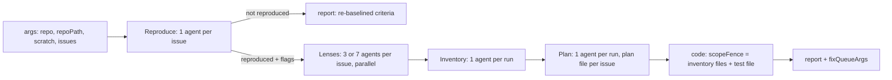

# Root-Cause Gate Before Fix-Queue - Plan

## Goal Capsule

- Objective: a lead who runs a bug bash with this plugin fixes the whole defect class an issue belongs to, with a named proof test, instead of only the sentences the issue text names; and every agent on the team sorts leftover gaps by one rule.
- Means: a saved Workflow `root-cause-gate` that runs before fix-queue and emits a per-class plan file and a per-issue `scopeFence` (KTD1, KTD2), plus one shared `residual-rule.md` reference (KTD4).
- Authority: issue #208 acceptance criteria, then this plan's R-IDs, then KTDs.
- Stop conditions: stop if a test cannot be made to fail first.
- Execution profile: one PR, branch `claude/root-cause-gate-208`, test-first. The lead session in the project thread finishes and ships it.

---

## Product Contract

### Summary

Add a root-cause gate that a lead runs per issue or per group before fix-queue. It reproduces each issue on current main, runs independent lens reviewers to name the defect class, inventories every site of that class, names the proving test tier and failing test, and writes one combined plan with a plan file and scope fence per issue. Add a residual rule that the gate, fixer, verifier and lead cite to decide which gaps are fixed now and which are filed.

### Problem Frame

fix-queue starts at admission. Its admission agent guesses the files a fix touches from issue text, and the fixer works inside that guess. In a sibling plugin's bug bash (2026-11-20 to 2026-11-22), a fix closed the two sentences two issues named while the same defect stayed in about nine other files; it took a revert, a retriage, two REWORK rounds and a maintainer scope review. That bug bash now restates a gate by hand in its routine prompt. The owner decided on 2026-11-22 to move the gate and the residual rule into this plugin.

### Requirements

- R1. The gate reproduces each issue on current main and, when an issue no longer reproduces, reports that and returns re-baselined acceptance criteria for it instead of planning a fix.
- R2. The gate runs independent root-cause reviewers, one lens each, given only the issue numbers and the repo path. It uses all seven lenses (requirements, architecture, design, quality, business, engineering, process) when the issue touches a contract, an ADR, a hook, or unattended use, and otherwise requirements, design and quality.
- R3. Each lens reviewer returns root causes and a defect class with file:line evidence.
- R4. The gate inventories every site of the defect class, every claim that cites the issue, and any repo-declared matrix.
- R5. The gate names the test tier that proves the behaviour, from tiers the target repo declares, and specifies the failing test to write first.
- R6. The gate writes one combined plan for the defect class and outputs, per reproducing issue, a plan file and a scope fence that fix-queue accepts as `scopeFence`.
- R7. Repo-specific tiers and matrices come from the target repo (its CLAUDE.md or `docs/agents/`), never from the plugin.
- R8. A residual rule exists as one reference file, with the six ordered questions from #208, and the gate, the fixer profile, the verifier profile and the lead's dispatch guidance cite it.
- R9. The skill page states the cost: subagents per issue and the lens selection rule.
- R10. The decisions on name, trigger and relation to #134 are recorded.

### Key Decisions

- The gate and the residual rule live in this plugin, beside fix-queue. (session-settled: user-directed — chosen over keeping them hand-restated in a sibling plugin's routine prompt: one home, so every repo's bug bash gets them.) Governs R1–R9.

### Acceptance Examples

- AE1. Covers R4, R6. Given an issue whose text names one file, when lens reviewers name a defect class whose inventory finds the same defect in two further files, then that issue's scope fence names all three files and the test file.
- AE2. Covers R1. Given an issue that no longer reproduces on main, when the gate runs, then the report lists it as not reproduced with re-baselined acceptance criteria, no lens reviewers run for it, and it has no scope fence.

### Scope Boundaries

- Not built: a `plans` argument on fix-queue. #208 says that is a separate issue; the gate writes plan files and names their paths so a later change can pass them.
- Not built: clustering across the backlog or a spawned-vs-closed ratio. That stays with #134 (KTD6).
- Not built: the gate committing the failing test. Considered and rejected because the fixer profile bars edits outside ce-work (KTD3); evidence that would change it: fix-queue gaining a test-first commit step.

#### Deferred to Follow-Up Work

- Repo reference files STRATEGY.md, ARCHITECTURE.md and QUALITY.md are absent from this repo.

---

## Planning Contract

### Key Technical Decisions

- KTD1. The gate is a saved Workflow `workflows/root-cause-gate.js`, run as `integral-productivity-engineering:root-cause-gate`, with a short skill page `skills/root-cause-gate-guide/SKILL.md` for trigger, cost and output. (session-settled: user-directed — chosen over a skill only: a Workflow enforces each step, fans the lenses out, and runs in the stub harness.) The skill page takes a distinct name because plugin workflows already appear in the skill namespace (fix-queue does), so a same-name skill could shadow the workflow or be shadowed by it.
- KTD2. The scope fence is built in code, not written by an agent. Each issue's lens reviewers name its defect class; the inventory agent returns sites keyed by defect class; the plan agent writes one plan file per class and names its test file. An issue's fence is the files of its class's sites plus that test file, so issues sharing a class share a fence. This makes AE1 deterministic and keeps the fence from shrinking back to the issue text.
- KTD3. The gate names the failing test (tier, file, assertion intent) in the plan file with a test-first execution note; the fixer writes it through ce-work. The gate edits nothing in the target repo.
- KTD4. `residual-rule.md` lives in `skills/writing-dispatch-prompts/reference/`, because the fixer and verifier already resolve plugin references from that directory; the gate's skill page and the lead's guidance link to it there.
- KTD5. Lens selection is a code rule over flags the reproduce agent returns (`touchesContract`, `touchesAdr`, `touchesHook`, `unattended`): any true selects seven lenses, otherwise three. A lead may force `lenses: 'all'`.
- KTD6. #134 stays separate and may consume the gate's defect class. (session-settled: user-directed — chosen over folding #134 into #208 or deciding later: the gate works per issue, #134 across the backlog.)
- KTD7. CI gains one job that runs every `tools/*.test.mjs` file with `node --test`. All three existing tool suites pass today but no CI job runs them.

### High-Level Technical Design

---

## Implementation Units

### U1. Residual rule reference and citations

- Goal: one residual-rule file that four roles cite.
- Requirements: R8.
- Dependencies: none.
- Files: `skills/writing-dispatch-prompts/reference/residual-rule.md`, `skills/writing-dispatch-prompts/SKILL.md`, `agents/fixer.md`, `agents/verifier.md`, `tools/residual-rule.test.mjs`.
- Approach: write the definition of a residual and the six ordered questions from #208; add a line to the fixer and verifier profiles and a bullet to the SKILL.md reference list.
- Execution note: write the test first and see it fail.
- Patterns to follow: existing bullets in "Fixer and verifier references"; `tools/check-ce-pins.test.mjs` reads repo files.
- Test scenarios:
  - The reference file exists and lists six numbered questions in the issue's order (correctness, introduced by the fix, same class, cheap and reversible, maintainer decision, file an issue).
  - It states that process reasons never qualify a gap for filing.
  - `agents/fixer.md` and `agents/verifier.md` each cite `reference/residual-rule.md`.
  - The writing-dispatch-prompts SKILL.md reference list links it.
- Verification: the test passes; the internal-refs check passes.

### U2. BDD scenarios for the gate (failing first)

- Goal: stub-harness scenarios that pin the gate's behaviour before it exists.
- Requirements: R1, R2, R3, R6, R9.
- Dependencies: none.
- Files: `tools/root-cause-gate.test.mjs`.
- Approach: mirror `tools/fix-queue.test.mjs`: load the workflow body, stub `agent()`, `parallel()`, `phase()`, `log()`. Name tests in Given/When/Then form.
- Execution note: the suite must fail because the workflow file is missing.
- Test scenarios:
  - Covers AE1. Given an issue naming one file and an inventory with two more sites for its defect class, when the gate runs, then `scopeFence[n]` names all three files and the test file, and `fixQueueArgs.issues` holds `n`.
  - Given two issues whose lenses name the same defect class, when the gate runs, then both get the same fence and one plan file; given two classes, each issue's fence holds only its own class's files.
  - Covers AE2. Given a non-reproducing issue, when the gate runs, then it is in `notReproduced` with re-baselined criteria, no lens agent ran for it, and `scopeFence` lacks it.
  - Given an issue flagged as touching a hook, when the gate runs, then seven lens agents run; given no flags, three run.
  - Given `lenses: 'all'`, seven run regardless of flags.
  - Each lens prompt contains only the issue numbers and repo path, not another lens's output.
  - Invalid args (missing repo, bad path, empty issues) throw before any agent runs.
  - `meta` is a pure literal, and every phase used is declared.
- Verification: suite runs and fails for the missing script only.

### U3. The root-cause-gate workflow

- Goal: make U2 pass.
- Requirements: R1–R7.
- Dependencies: U2.
- Files: `workflows/root-cause-gate.js`.
- Approach: validate args like fix-queue; reproduce, lenses, inventory, plan phases; build the scope fence in code (KTD2); return a report with `reproduced`, `notReproduced`, `scopeFence`, `planFiles`, `fixQueueArgs`. Prompts tell agents to read tiers and matrices from the target repo (R7) and cite the residual rule.
- Patterns to follow: `workflows/fix-queue.js` arg validation and schemas.
- Test scenarios: see U2.
- Verification: `node --test tools/root-cause-gate.test.mjs` passes.

### U4. Skill page, ADR and wiring

- Goal: a lead can find, trigger and cost the gate; the decisions are recorded.
- Requirements: R9, R10.
- Dependencies: U3.
- Files: `skills/root-cause-gate-guide/SKILL.md`, `docs/adr/0007-run-a-root-cause-gate-before-fix-queue.md`, `skills/writing-dispatch-prompts/reference/fix-queue-workflow.md`, `CLAUDE.md`, `.github/workflows/ci.yml`.
- Approach: SKILL.md description triggers on bug bash / before fix-queue / root cause; states the cost (per issue: 1 reproduce, 3 or 7 lenses; per run: 1 inventory, 1 plan) and the lens rule; ADR-0007 records KTD1, KTD4, KTD6; fix-queue doc says how to pass the gate's `scopeFence`; CI job per KTD7 runs `node --test tools/*.test.mjs` on Node 22.
- Test expectation: covered by U1 (citation) and U2 (behaviour); the SKILL.md cost statement is pinned by one assertion in `tools/root-cause-gate.test.mjs`.
- Verification: all `tools/*.test.mjs` pass locally; CI green.

---

## Verification Contract

- `node --test tools/*.test.mjs` (Node 22, no dependencies) passes, including the new suites. The bare directory form `node --test tools/` does not discover the suites.
- `node tools/check-internal-refs.mjs` passes.
- CI on the PR is green, including the new tests job.

## Definition of Done

- R1–R10 hold, AE1 and AE2 are pinned by tests.
- No dead-end or experimental code remains in the diff.
- The PR body links #208, names the open decisions, and lists What emerged and Follow-ups.
